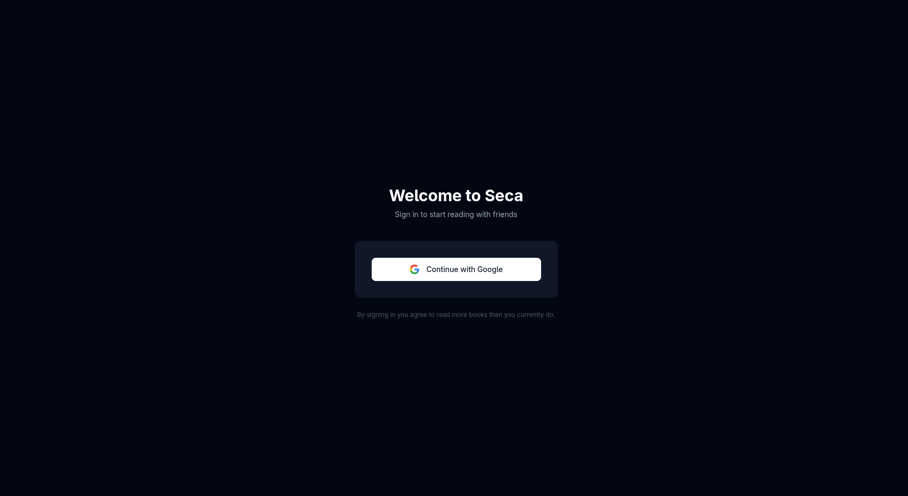
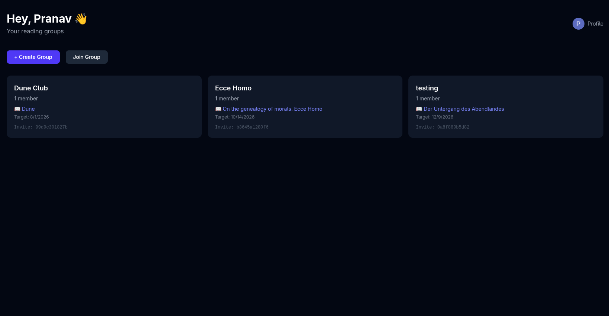
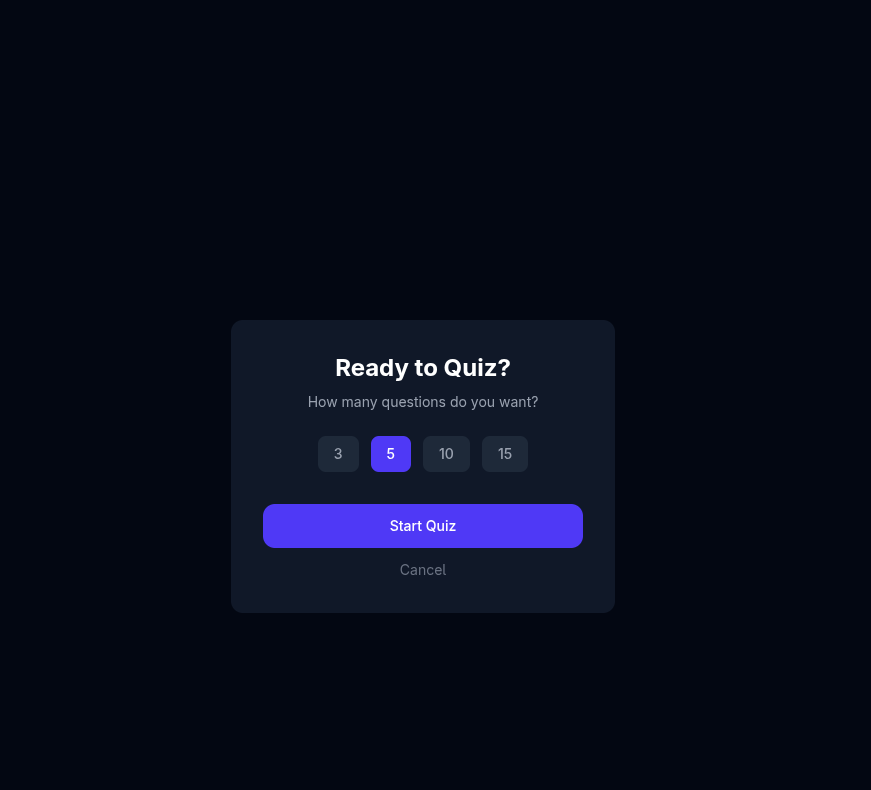
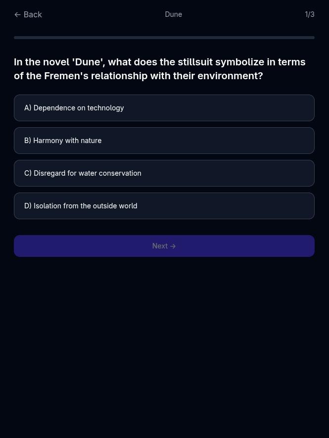
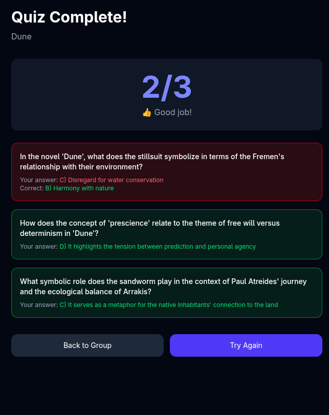

# Seca

> **Social reading, reimagined.** Read books with friends, take AI-generated quizzes, and climb the leaderboard.

[](https://seca-xi.vercel.app)
[](https://seca-bazy.onrender.com)
[](https://github.com/ReitardXd/seca)

Seca is a full-stack social reading platform where friend groups compete to finish the same book. It combines Goodreads-style book tracking with AI-generated quizzes and a competitive leaderboard — think *Goodreads × Kahoot × Duolingo* but actually integrated.

---

## Screenshots

| Login | Dashboard |
|-------|-----------|
|  |  |

| Quiz Setup | Quiz Question | Results |
|------------|---------------|---------|
|  |  |  |

---

## Features

- **Google OAuth login** — no passwords to manage
- **Book search** — powered by the Open Library API
- **Reading groups** — create groups with unique invite codes
- **Invite friends** — share the code to let anyone join
- **Group book selection** — set a book for the entire group to read
- **Progress tracking** — log pages read with visual progress bars
- **Reading streaks** — track daily reading consistency
- **AI quizzes** — multiple-choice questions generated by Groq's Llama 3.3 70B, tailored to your book
- **Flexible quiz length** — choose 3, 5, 10, or 15 questions
- **Scoring & results** — see how you stack up after each quiz
- **Leaderboard** — ranked by quiz scores within each group

---

## Tech Stack

| Layer      | Technology                                      |
| ---------- | ----------------------------------------------- |
| Frontend   | React, Vite, Tailwind CSS, React Router, Axios  |
| Backend    | Node.js, Express 5, Mongoose                    |
| Database   | MongoDB Atlas                                   |
| Auth       | Google OAuth 2.0 + JWT                          |
| AI         | Groq API (llama-3.3-70b-versatile)              |
| Books API  | Open Library API                                |
| Hosting    | Vercel (frontend), Render (backend)             |

---

## Local Setup

### Prerequisites

- Node.js >= 18
- A MongoDB Atlas cluster (or local MongoDB instance)
- Google OAuth 2.0 credentials ( [Google Cloud Console](https://console.cloud.google.com) )
- A Groq API key ( [Groq Console](https://console.groq.com) )

### 1. Clone the repo

```bash
git clone https://github.com/ReitardXd/seca.git
cd seca
```

### 2. Server setup

```bash
cd server
npm install
```

Create a `.env` file in `server/`:

```env
PORT=5000
MONGO_URI=your_mongodb_connection_string
JWT_SECRET=your_jwt_secret
CLIENT_URL=http://localhost:5173
GOOGLE_CLIENT_ID=your_google_client_id
GOOGLE_CLIENT_SECRET=your_google_client_secret
GROQ_API_KEY=your_groq_api_key
```

Start the server:

```bash
npm run dev
```

### 3. Client setup

Open a new terminal:

```bash
cd client
npm install
```

Create a `.env` file in `client/`:

```env
VITE_API_URL=http://localhost:5000
```

Start the client:

```bash
npm run dev
```

### 4. Open the app

Visit [http://localhost:5173](http://localhost:5173) in your browser.

---

## Project Structure

```
seca/
├── client/          # React frontend (Vite)
│   ├── src/
│   │   ├── components/
│   │   ├── pages/
│   │   ├── context/
│   │   └── ...
│   └── ...
└── server/          # Express backend
    ├── config/
    ├── controllers/
    ├── middleware/
    ├── models/
    ├── routes/
    ├── services/
    ├── utils/
    └── index.js
```

---

## Live Demo

- **Frontend:** [https://seca-xi.vercel.app](https://seca-xi.vercel.app)
- **Backend API:** [https://seca-bazy.onrender.com](https://seca-bazy.onrender.com)
- **Repository:** [https://github.com/ReitardXd/seca](https://github.com/ReitardXd/seca)
